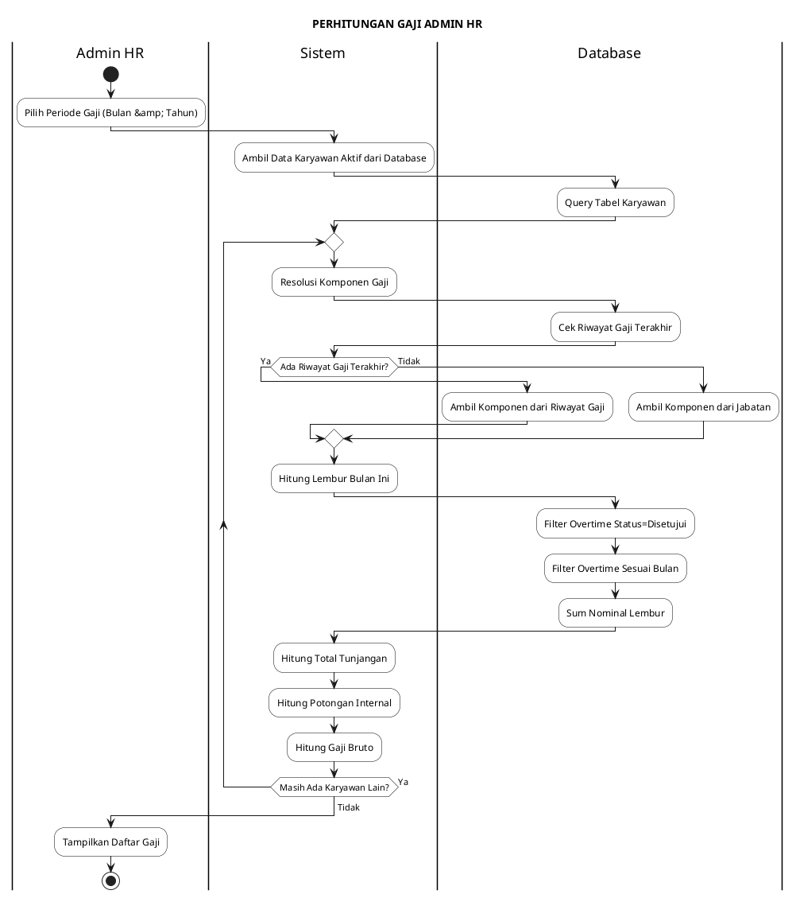
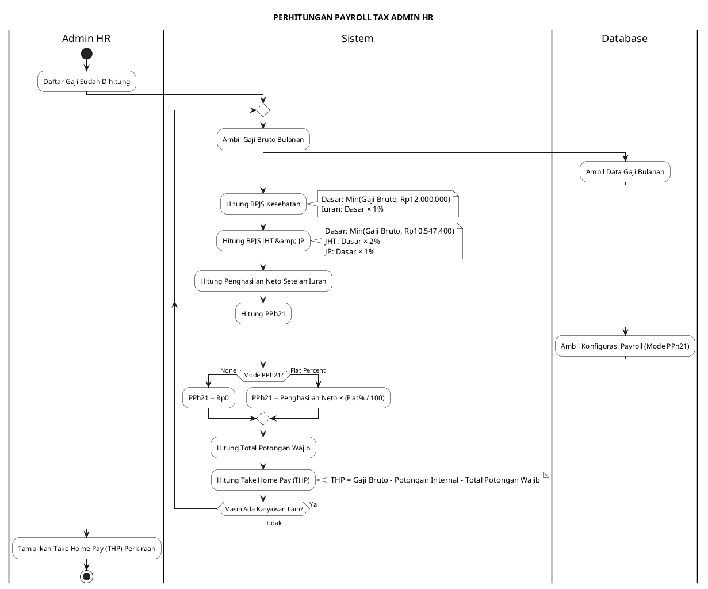
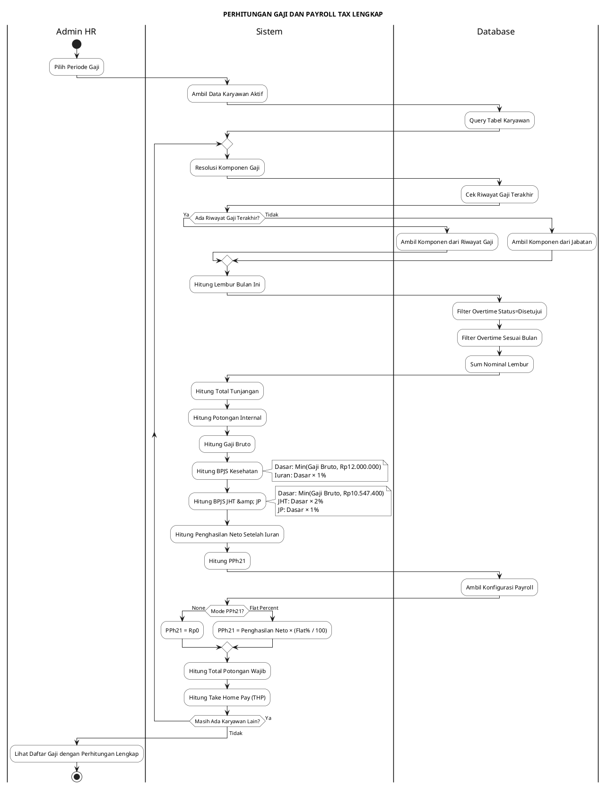
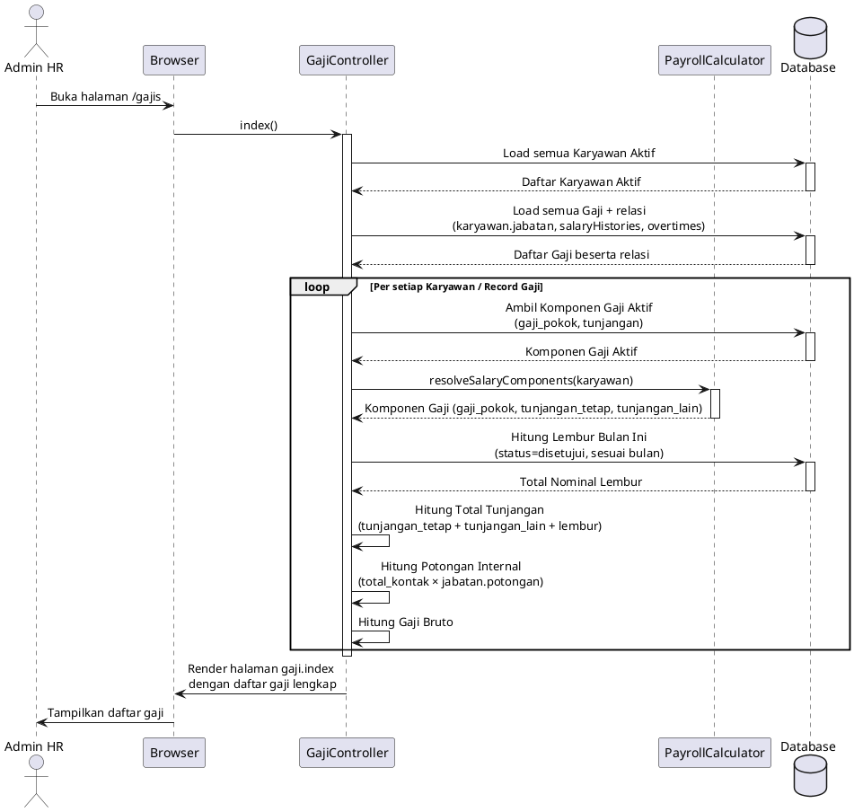
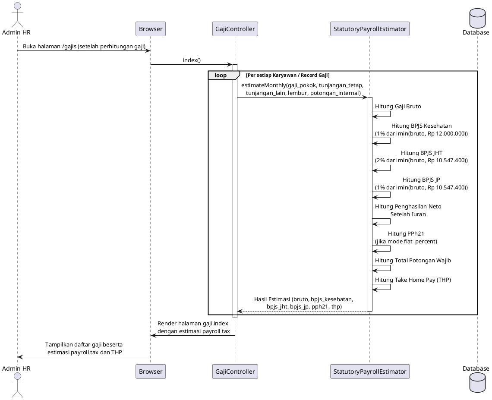

# Diagram Activity — Perhitungan Gaji dan Payroll Tax PILAR HR

Dokumen ini berisi diagram activity (DA) dan sequence dalam format PlantUML, dengan interaksi antara Admin HR, Sistem, dan Database.

---

## 1. Diagram Activity Perhitungan Gaji (DA Gaji)

---

## 2. Diagram Activity Perhitungan Payroll Tax (DA Payroll Tax)

---

## 3. Diagram Activity Lengkap (Gaji + Payroll Tax)

---

## 4. Diagram Sequence Perhitungan Gaji

---

## 5. Diagram Sequence Perhitungan Payroll Tax

---

## Keterangan:

1. **Perhitungan Gaji**:
   - Komponen gaji diambil dari riwayat gaji terakhir karyawan (tabel `employee_salary_histories`), jika tidak ada maka dari jabatan (tabel `jabatans`)
   - Lembur yang dihitung hanya yang berstatus "disetujui" dan sesuai bulan periode (tabel `overtimes`)
   - Potongan internal = total kontak × potongan jabatan (dari tabel `karyawans` dan `jabatans`)

2. **Perhitungan Payroll Tax**:
   - BPJS Kesehatan: dasar = min(gaji bruto, Rp12.000.000), iuran = 1%
   - BPJS JHT: dasar = min(gaji bruto, Rp10.547.400), iuran = 2%
   - BPJS JP: dasar = min(gaji bruto, Rp10.547.400), iuran = 1%
   - PPh21: bisa "none" (tidak dihitung) atau "flat percent" (persentase tetap), konfigurasi dari file `config/payroll.php`)
   - THP = gaji bruto - potongan internal - total potongan wajib

3. **Cara Melihat Diagram**:
   - **Activity &amp; Sequence Diagram (PlantUML)**: Salin kode PlantUML ke [plantuml.com/plantuml](https://www.plantuml.com/plantuml/)
   - Atau gunakan ekstensi PlantUML di VS Code
   - Atau gunakan plantuml.jar yang sudah ada di direktori `docs/`

4. **Referensi Kode**:
   - [GajiController.php](file:///c:/xampp/htdocs/Aplikasi%20HR%20Karyawan/app/Http/Controllers/GajiController.php)
   - [PayrollCalculator.php](file:///c:/xampp/htdocs/Aplikasi%20HR%20Karyawan/app/Support/PayrollCalculator.php)
   - [StatutoryPayrollEstimator.php](file:///c:/xampp/htdocs/Aplikasi%20HR%20Karyawan/app/Support/StatutoryPayrollEstimator.php)
   - [payroll.php](file:///c:/xampp/htdocs/Aplikasi%20HR%20Karyawan/config/payroll.php)

