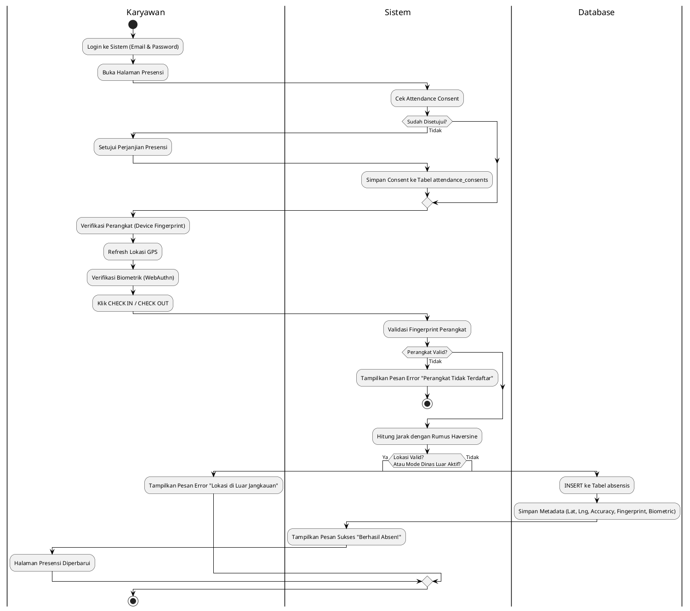

# Diagram Activity Presensi Karyawan PILAR HR

## 1. Activity Diagram Presensi Lengkap (Mermaid.js dengan Swimlane)

```mermaid
graph TD
    subgraph Karyawan
        Start([Mulai Presensi]) --> Login[Login ke Sistem]
        Login --> BukaPresensi[Buka Halaman Presensi]
        BukaPresensi --> CekConsent{Cek Attendance Consent}
        CekConsent -->|Belum Disetujui| SetujuiConsent[Setujui Perjanjian Presensi]
        SetujuiConsent --> VerifDevice[Verifikasi Perangkat]
        CekConsent -->|Sudah Disetujui| VerifDevice
        VerifDevice --> RefreshGPS[Refresh Lokasi GPS]
        RefreshGPS --> VerifBiometric[Verifikasi Biometrik (Opsional)]
        VerifBiometric --> KlikCheck[Klik CHECK IN/OUT]
    end

    subgraph Sistem
        KlikCheck --> ValidasiDevice{Validasi Fingerprint}
        ValidasiDevice -->|Tidak Valid| GagalDevice[❌ Perangkat Tidak Valid]
        GagalDevice --> End([Selesai])
        ValidasiDevice -->|Valid| HitungJarak[Hitung Jarak Lokasi]
        HitungJarak --> CekLokasi{Lokasi Valid?}
        CekLokasi -->|Tidak| CekDinas{Mode Dinas Luar?}
        CekDinas -->|Tidak| GagalLokasi[❌ Lokasi Tidak Valid]
        GagalLokasi --> End
        CekDinas -->|Ya| SimpanAbsen[Simpan Data Absensi ke Database]
        CekLokasi -->|Ya| SimpanAbsen
    end

    subgraph Database
        SimpanAbsen --> InsertAbsen[INSERT ke Tabel absensis]
        InsertAbsen --> SimpanMeta[Simpan Metadata (GPS, Fingerprint, Biometrik)]
        SimpanMeta -->|Berhasil| BerhasilAbsen[✅ Berhasil Presensi!]
        BerhasilAbsen --> End
    end
```

## 2. Activity Diagram Presensi Lengkap (PlantUML dengan Swimlane)

### Kode PlantUML yang Diperbaiki:


### Cara Melihat Diagram Online:
1. Buka [PlantUML Online Server](http://www.plantuml.com/plantuml/)
2. Salin kode PlantUML di atas
3. Tempelkan ke kotak teks di halaman tersebut
4. Klik **Submit** untuk melihat diagram

Atau gunakan [PlantText](https://www.planttext.com/) untuk antarmuka yang lebih mudah.

## 3. Penjelasan Alur Secara Detail

### Langkah 1: Login ke Sistem
- Karyawan memasukkan **email** dan **password** di halaman login
- Sistem memverifikasi kredensial menggunakan Laravel Auth
- Jika berhasil, disimpan ke session dan redirect ke halaman portal

### Langkah 2: Cek Attendance Consent
- Sistem memeriksa apakah karyawan sudah **menyetujui perjanjian presensi** di tabel `attendance_consents`
- Jika belum, karyawan harus menyetujui terlebih dahulu sebelum bisa melakukan presensi
- Consent disimpan beserta **tanggal, waktu, dan alamat IP** untuk keperluan audit

### Langkah 3: Verifikasi Perangkat (Device Binding)
- Sistem **menghasilkan device fingerprint** dari data:
  - User Agent (jenis browser & OS)
  - Resolusi layar
  - Bahasa browser
  - Zona waktu
- Fingerprint kemudian dibandingkan dengan data di tabel `user_devices`
- **Satu akun hanya bisa dipakai di satu perangkat** untuk keamanan

### Langkah 4: Refresh Lokasi GPS & Geofencing
- Karyawan klik tombol **Refresh Lokasi**
- Browser meminta izin akses lokasi ke pengguna
- Setelah izin diberikan, browser mengirimkan **latitude, longitude, dan accuracy**
- Sistem menghitung jarak antara lokasi karyawan dengan lokasi presensi menggunakan **Rumus Haversine**
- Jika jarak ≤ radius (default 5 meter), lokasi dianggap valid
- **Mode Dinas Luar**: Karyawan bisa presensi tanpa harus berada di lokasi presensi

### Langkah 5: Verifikasi Biometrik (Opsional)
- Sistem mendeteksi apakah browser mendukung **WebAuthn API**
- Jika didukung, muncul prompt untuk verifikasi **Face ID, Fingerprint, atau Windows Hello**
- Credential disimpan di `localStorage` untuk digunakan di sesi berikutnya
- Verifikasi biometrik bersifat opsional tapi direkomendasikan untuk keamanan tambahan

### Langkah 6: Klik CHECK IN / CHECK OUT
- Karyawan klik tombol sesuai kebutuhan (masuk/pulang)
- Browser mengirimkan seluruh data ke server:
  - Lokasi (lat, lng, accuracy)
  - Device fingerprint
  - Biometric credential (jika ada)
  - Tipe absen (masuk/pulang)

### Langkah 7: Verifikasi Ulang di Server
- Server melakukan **double-check** untuk keamanan:
  1. Validasi device fingerprint sekali lagi
  2. Hitung jarak ulang di backend (tidak hanya mengandalkan data dari frontend)
  3. Cek apakah mode dinas luar aktif

### Langkah 8: Simpan ke Database
- Jika seluruh verifikasi berhasil, data presensi disimpan ke tabel `absensis`
- Semua **metadata disimpan** untuk keperluan audit:
  - `tanggal_absensi`: Tanggal presensi
  - `time`: Waktu presensi
  - `status_absen`: Status (hadir, izin, dll.)
  - `tipe_absen`: Masuk atau pulang
  - `latitude` & `longitude`: Koordinat GPS
  - `accuracy`: Akurasi GPS
  - `jarak_meter`: Jarak dari lokasi presensi
  - `attendance_location_id`: ID lokasi presensi
  - `device_fingerprint`: Fingerprint perangkat
  - `biometric_credential_id`: ID credential biometrik
  - `biometric_verified`: Apakah biometrik diverifikasi
  - `lokasi_dinas`: Apakah mode dinas luar aktif
  - `catatan`: Catatan tambahan
  - `user_agent`: User agent browser
  - `created_at` & `updated_at`: Waktu transaksi

## 4. Tabel Metadata yang Terkait

| Tabel | Kolom Penting | Keterangan |
|-------|----------------|------------|
| `users` | `id`, `name`, `email`, `password`, `role` | Data user login |
| `karyawans` | `id`, `nik`, `nama`, `jabatan_id`, `department_id`, `attendance_location_id` | Data master karyawan |
| `attendance_consents` | `id`, `user_id`, `jenis`, `disetujui`, `disetujui_pada`, `ip_address` | Perjanjian presensi |
| `absensis` | `id`, `karyawan_id`, `tanggal_absensi`, `time`, `status_absen`, `tipe_absen`, `latitude`, `longitude`, `accuracy`, `jarak_meter`, `attendance_location_id`, `device_fingerprint`, `biometric_credential_id`, `biometric_verified`, `lokasi_dinas`, `catatan`, `user_agent` | Riwayat presensi |
| `user_devices` | `id`, `user_id`, `device_fingerprint`, `device_label`, `user_agent`, `platform`, `registered_at`, `last_used_at` | Binding perangkat |
| `attendance_locations` | `id`, `nama`, `latitude`, `longitude`, `radius_meter`, `is_aktif` | Lokasi presensi |

## 5. Rumus Haversine (Perhitungan Jarak)
Untuk menghitung jarak antara 2 titik di permukaan bumi:
```
R = radius bumi (6371000 meter)
dLat = (lat2 - lat1) × π / 180
dLon = (lon2 - lon1) × π / 180
a = sin²(dLat/2) + cos(lat1) × cos(lat2) × sin²(dLon/2)
c = 2 × atan2(√a, √(1-a))
jarak = R × c
```

