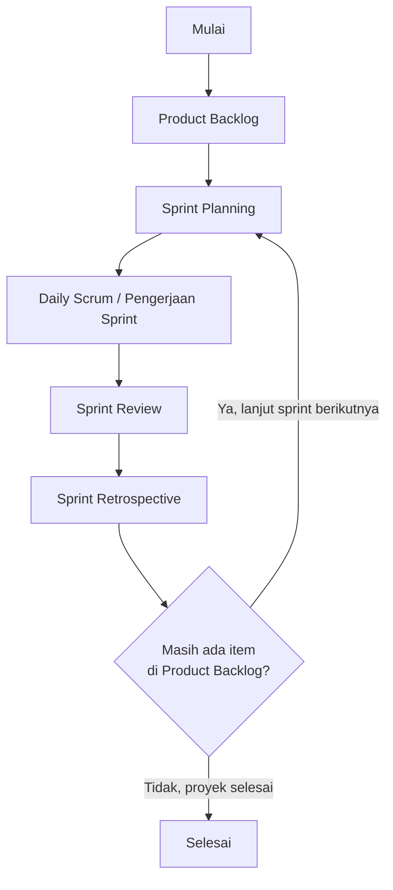
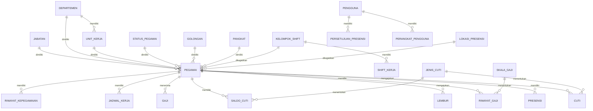
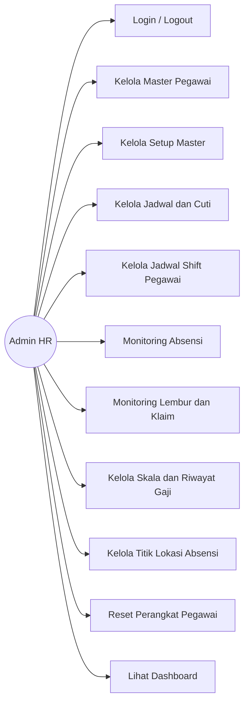
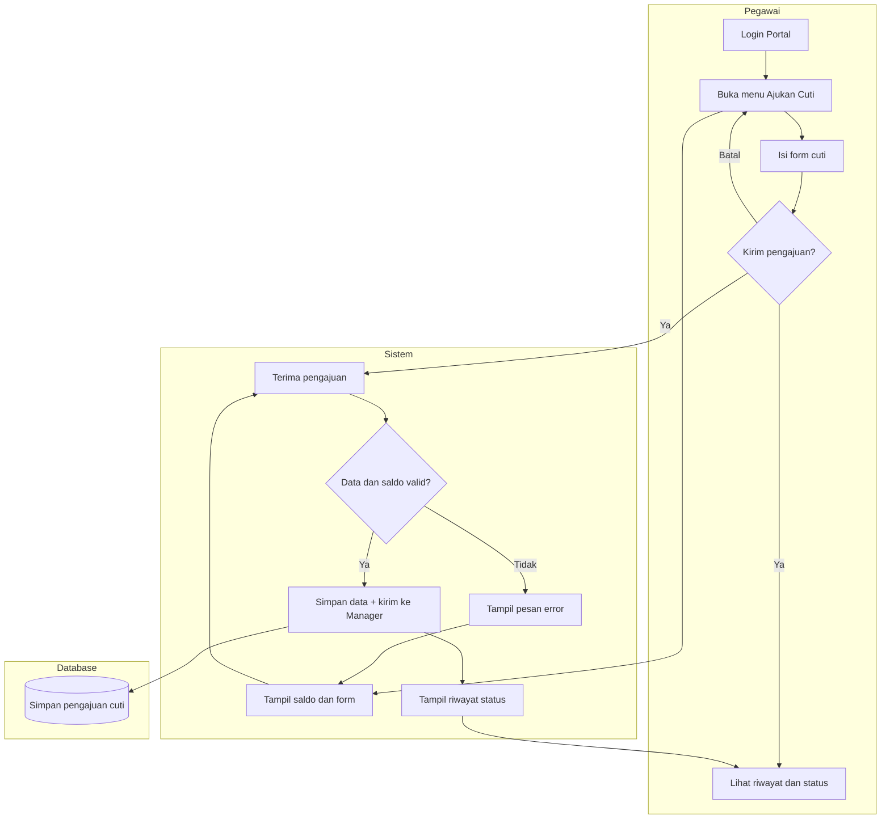

# Revisi Blueprint PILAR HR

File ini berisi perbaikan blueprint kami berdasarkan coretan dosen di `Revisi dosen.pdf`.  
Isinya sudah disusun biar tinggal disalin ke Word (`Blueprint Pilar Kel.9.docx`).

**Kelompok:** Grow in The Dark  
**Mitra:** PT Pilar Inovasi Informatika

---

## Apa saja yang dikomentari dosen?

| No | Bagian | Coretan dosen | Yang kami perbaiki |
|---|---|---|---|
| 1 | DAFTAR PERSAMAAN | Error bookmark + tanda tanya | Hapus / perbaiki field Word |
| 2 | DAFTAR TABEL | Ada yang tipis, ada yang tebal | Samakan format |
| 3 | Tujuan Proyek | Minta paragraf pendahuluan | Tambah paragraf sebelum daftar tujuan |
| 4 | Batasan Proyek | “Apakah ini batasan?” | Pisah jadi ruang lingkup dan batasan |
| 5 | Tabel 1.1 | “Metode apa?” | Lengkapi judul tabel |
| 6 | Flowchart Agile | “Ini agile?” | Ubah flowchart supaya siklus sprint |
| 7 | Sprint 1 & 2 | Dilingkari tanda tanya | Jelaskan fokus Capstone 1 |
| 8 | Gambar Login | Tanda tanya | Sebut nomor gambar di paragraf |
| 9 | Kebutuhan FR/NFR | “Mana fungsional mana non fungsional?” | Rapikan pembagiannya |
| 10 | Gambar arsitektur | “Dirujuk di paragraf mana?” | Tambah kalimat rujukan |
| 11 | ERD Chen | Dicoret “Chen” | Ganti caption + hubungkan entitas |
| 12 | Use Case Admin | “Ini use case?” | Gabung jadi satu diagram |
| 13 | Activity Cuti | “Disebut di paragraf mana?” | Rujuk Gambar 3.32 + perbaiki typo |

---

## 1. DAFTAR PERSAMAAN

**Masalah:** di daftar isi keluar tulisan `Error! Bookmark not defined.`

**Perbaikan:**
- Kalau memang tidak ada rumus/persamaan di laporan, hapus saja bagian DAFTAR PERSAMAAN.
- Kalau ada rumus, kasih caption persamaan dulu (contoh: Persamaan 1.1), lalu update daftar isi di Word (klik kanan daftar isi → Update Field).

---

## 2. DAFTAR TABEL

**Masalah:** format huruf tidak sama. Tabel 2.2 biasa, Tabel 2.3 tebal.

**Perbaikan:** samakan semua jadi huruf biasa (tidak ada yang ditebalkan sendiri).

Contoh daftar tabel setelah diperbaiki:

```
Tabel 1.1. Perbandingan metode pengembangan, platform aplikasi, dan framework
Tabel 1.2. Timeline Sprint
Tabel 1.3. Lembar persetujuan dokumen C-1
Tabel 2.1. Kebutuhan Pengguna
Tabel 2.2. Metode Pengujian
Tabel 2.3. Lembar persetujuan dokumen C-2
Tabel 3.1. Modul Utama Aplikasi
Tabel 3.2. Entitas Database
Tabel 3.3. Fitur Keamanan
Tabel 3.4. Tahapan Implementasi
Tabel 3.5. Jadwal Pengembangan
Tabel 3.6. Lembar persetujuan dokumen C-3
```

---

## 3. C. Tujuan Proyek

**Masalah:** langsung loncat ke poin 1–6, belum ada paragraf pembuka.

**Teks perbaikan (tinggal copy ke Word):**

**C. Tujuan Proyek**

Berdasarkan permasalahan yang sudah dijelaskan pada latar belakang serta kebutuhan mitra terhadap sistem kepegawaian yang terintegrasi, maka pada proyek Capstone ini disusun beberapa tujuan yang ingin dicapai. Tujuan tersebut digunakan sebagai acuan selama proses analisis, perancangan, sampai pengembangan sistem PILAR HR dengan metode Agile Scrum.

Adapun tujuan dari proyek ini adalah sebagai berikut:

1. Membangun sistem Human Resource Management berbasis web yang terintegrasi.
2. Mempermudah pengelolaan data pegawai dalam satu sistem terpusat.
3. Memfasilitasi proses presensi, pengajuan cuti, dan evaluasi kinerja secara digital.
4. Menyediakan laporan sumber daya manusia yang akurat dan mudah diakses.
5. Meningkatkan efisiensi proses administrasi sumber daya manusia.
6. Menerapkan metode Agile Scrum dalam implementasi sistem agar dapat beradaptasi terhadap perubahan kebutuhan pengguna.

---

## 4. D. Batasan Proyek

**Masalah:** banyak poin yang isinya “sistem menyediakan fitur …”. Menurut dosen, itu lebih ke ruang lingkup, bukan batasan. Selain itu belum ada paragraf di awal subbab.

**Teks perbaikan:**

**D. Ruang Lingkup dan Batasan Proyek**

### D.1 Ruang Lingkup Proyek

Pada bagian ini dijelaskan cakupan sistem yang dikerjakan pada proyek PILAR HR. Untuk Capstone 1 fokusnya masih pada analisis dan perancangan, sedangkan implementasi penuh dilanjutkan pada Capstone 2. Ruang lingkup ini disusun berdasarkan kebutuhan mitra PT Pilar Inovasi Informatika.

Adapun ruang lingkup sistem meliputi:

1. Proses Human Resource Management pada organisasi mitra.
2. Autentikasi pengguna dan pengelolaan role.
3. Master data pegawai (data umum, kepegawaian, payroll/pajak, dan riwayat).
4. Presensi pegawai melalui portal (termasuk lokasi dan perangkat).
5. Pengajuan dan persetujuan cuti.
6. Pengajuan dan persetujuan lembur serta klaim.
7. Pengelolaan jadwal shift, hari libur, dan data master pendukung.
8. Modul penggajian berkala (skala gaji, riwayat gaji, dan rekap gaji).
9. Dashboard untuk memantau kehadiran, cuti, dan data kepegawaian.
10. Penyimpanan dokumen pendukung, misalnya lampiran cuti dan dokumen persetujuan absensi.

### D.2 Batasan Proyek

Batasan proyek dibuat supaya pengerjaan Capstone tetap fokus dan tidak melebar ke fitur di luar kesepakatan.

Adapun batasan proyek ini adalah sebagai berikut:

1. Sistem dibangun berbasis web dan diakses melalui browser.
2. Capstone 1 hanya mencakup analisis kebutuhan dan perancangan sistem. Coding secara penuh dikerjakan pada Capstone 2.
3. Sistem tidak mencakup integrasi dengan aplikasi pihak ketiga di luar ruang lingkup mitra, misalnya mesin fingerprint eksternal atau ERP luar.
4. Sistem tidak mencakup modul rekrutmen, asesmen psikologi, atau pelatihan.
5. Perhitungan pajak dan BPJS pada modul gaji masih berupa perkiraan, bukan sistem pelaporan pajak resmi.
6. Pengujian dilakukan di lingkungan development/staging. Untuk produksi mengikuti kebijakan mitra.

---

## 5. Tabel 1.1

**Masalah:** judulnya cuma “Perbandingan metode”, jadi dosen nanya “metode apa?”

**Judul baru:**

**Tabel 1.1. Perbandingan metode pengembangan, platform aplikasi, dan framework**

| Alternatif | Kelebihan | Kekurangan |
|---|---|---|
| Metode Waterfall | Tahapannya jelas dan mudah didokumentasikan | Susah menyesuaikan kalau kebutuhan berubah di tengah jalan |
| Metode Agile Scrum | Lebih fleksibel, dikerjakan per sprint, dan lebih sering diskusi dengan pengguna | Butuh koordinasi tim yang aktif |
| Desktop Application | Bisa dipakai tanpa internet | Harus instal di tiap perangkat dan kurang fleksibel |
| Web-Based Application | Bisa dibuka lewat browser dari berbagai perangkat | Tetap butuh internet dan server |
| Framework Native PHP | Ringan dan strukturnya sederhana | Pengembangan lebih lama karena banyak yang dibuat manual |
| Framework Laravel | Sudah ada autentikasi, keamanan, ORM, routing, dan struktur kode yang rapi | Butuh spesifikasi server yang lebih baik dibanding PHP native |

**Paragraf setelah tabel:**

Berdasarkan perbandingan di atas, proyek ini memilih metode Agile Scrum, platform web, dan framework Laravel. Agile Scrum dipilih karena cocok untuk proyek yang kebutuhannya bisa berubah di setiap sprint. Platform web dipilih agar HR, manajer, dan pegawai bisa mengakses sistem lewat browser tanpa instal aplikasi. Laravel dipilih karena sudah menyediakan banyak fitur bawaan seperti autentikasi, keamanan, Eloquent ORM, dan struktur MVC sehingga mempermudah pengembangan.

---

## 6. Gambar 1.1 Metode Pengembangan

**Masalah:** flowchart lama terlalu linear, lalu langsung selesai. Dosen bilang “ini agile?”

**Gambar perbaikan:**

**Gambar 1.1. Metode Pengembangan Agile Scrum**



**Penjelasan di bawah gambar:**

Gambar 1.1 menunjukkan alur pengembangan menggunakan Agile Scrum. Setelah Product Backlog dibuat, tim melakukan Sprint Planning, lalu mengerjakan sprint sambil melakukan Daily Scrum. Setelah itu dilakukan Sprint Review dan Sprint Retrospective. Kalau masih ada pekerjaan di backlog, maka dilanjutkan ke sprint berikutnya. Jadi prosesnya berulang, bukan langsung selesai dalam satu kali alur seperti Waterfall.

---

## 7. Sprint 1 dan Sprint 2

**Masalah:** kalimat “sampai Sprint 1 dan Sprint 2” dilingkari dosen, seolah kurang jelas.

**Teks perbaikan:**

Metode yang digunakan pada proyek Sistem Human Resource Management (PILAR HR) berbasis web adalah Agile Scrum. Metode ini dipilih karena pengerjaan bisa dilakukan secara bertahap, sehingga setiap hasil sprint bisa dicek dan diperbaiki sesuai kebutuhan pengguna.

Pada Capstone 1, ruang lingkup kami masih sebatas analisis kebutuhan dan perancangan sistem. Karena itu, Sprint 1 dan Sprint 2 pada tahap ini difokuskan untuk analisis dan desain, bukan untuk coding fitur secara penuh.

Pada Sprint 1, kami menyusun identifikasi stakeholder, analisis proses bisnis, Product Backlog, kebutuhan fungsional dan non-fungsional, serta use case diagram awal. Pada Sprint 2, kami melanjutkan ke desain arsitektur, ERD, antarmuka, activity/sequence diagram, serta rencana keamanan dan implementasi.

Untuk tahap coding, integrasi, dan pengujian sistem secara keseluruhan akan dilanjutkan pada Capstone 2 melalui sprint berikutnya.

| Sprint | Tahap | Fokus |
|---|---|---|
| Sprint 1 | Capstone 1 | Analisis kebutuhan, Product Backlog, use case, arsitektur awal |
| Sprint 2 | Capstone 1 | ERD, UI, activity/sequence, keamanan, rencana implementasi |
| Sprint 3 dst. | Capstone 2 | Coding modul, integrasi, pengujian, perbaikan |

---

## 8. Deskripsi Sistem dan Gambar 2.1 / 2.2

**Masalah:** gambar login dan dashboard ada, tapi belum disebut jelas di paragraf.

**Teks perbaikan:**

**A. Deskripsi Sistem**

PILAR HR adalah sistem Human Resource Management berbasis web yang dibuat untuk membantu pengelolaan data dan aktivitas kepegawaian secara digital. Fitur yang disediakan antara lain pengelolaan data pegawai, presensi, pengajuan cuti, jadwal shift, lembur, dan rekap gaji.

Sebelum masuk ke sistem, pengguna harus login terlebih dahulu. Tampilan halaman login dapat dilihat pada **Gambar 2.1 Halaman Login**. Pengguna memasukkan email dan password sesuai akun masing-masing, baik sebagai Admin HR, Manager/Atasan, maupun Pegawai.

Setelah login berhasil, pengguna akan diarahkan ke halaman utama sesuai role-nya. Untuk Admin HR, ringkasan data sistem ditampilkan pada dashboard. Tampilan dashboard tersebut dapat dilihat pada **Gambar 2.2 Halaman Dashboard PILAR HR**. Pada dashboard terdapat ringkasan kehadiran, cuti, dan menu menuju modul-modul utama.

**Gambar 2.1. Halaman Login**  
**Gambar 2.2. Halaman Dashboard PILAR HR**

Catatan: pastikan screenshot-nya jelas dan tidak buram.

---

## 9. Kebutuhan Fungsional dan Non-Fungsional

**Masalah:** dosen mempertanyakan mana yang fungsional dan mana yang non-fungsional.

**Cara bedainnya sederhana:**
- Fungsional = fitur yang bisa dilakukan user di sistem
- Non-fungsional = kualitas sistem, misalnya keamanan, performa, dan aksesibilitas

**Teks perbaikan:**

**B. Kebutuhan Fungsional**

Kebutuhan fungsional adalah fitur-fitur yang harus ada pada sistem.

1. Sistem dapat melakukan login dan logout sesuai role pengguna (Admin HR, Manager/Atasan, Pegawai).
2. Sistem dapat mengelola data master pegawai (tambah, ubah, hapus, dan lihat detail).
3. Sistem dapat mengelola data master pendukung seperti jabatan, golongan, pangkat, status pegawai, departemen, dan unit kerja.
4. Sistem dapat mencatat presensi masuk dan pulang pegawai melalui portal.
5. Sistem dapat menerima pengajuan cuti dan menampilkan status persetujuannya.
6. Sistem dapat menerima pengajuan lembur/klaim dan menampilkan status persetujuannya.
7. Sistem dapat menampilkan dashboard ringkasan kehadiran, cuti, dan data terkait.
8. Sistem dapat mengelola jadwal shift, hari libur, jenis cuti, dan saldo cuti.
9. Sistem dapat menampilkan rekap atau riwayat gaji sesuai hak akses pengguna.
10. Sistem dapat mengelola titik lokasi absensi dan menugaskannya ke pegawai.

**C. Kebutuhan Non-Fungsional**

Kebutuhan non-fungsional berkaitan dengan kualitas dan batasan teknis sistem.

1. Sistem dapat diakses melalui browser di perangkat desktop maupun mobile.
2. Setiap pengguna wajib login, dan password disimpan dalam bentuk hash (tidak plain text).
3. Data disimpan secara terpusat di database MySQL.
4. Halaman portal dan dashboard tetap responsif saat dijalankan di lingkungan lokal/staging.
5. Backup data dilakukan secara berkala sesuai kebijakan mitra.
6. Presensi dilengkapi pengamanan tambahan seperti device binding, geofencing, dan persetujuan dokumen absensi.
7. Hak akses menu dibedakan berdasarkan role pengguna.

---

## 10. Gambar 3.1 Desain Arsitektur

**Masalah:** gambar sudah ada, tapi belum disebut di paragraf.

**Teks perbaikan:**

**B. Desain Arsitektur Sistem**

PILAR HR dibangun dengan arsitektur berlapis (Layered Architecture) menggunakan framework Laravel. Desain arsitektur sistem tersebut dapat dilihat pada **Gambar 3.1 Desain Arsitektur Sistem**. Pada gambar tersebut terlihat pembagian lapisan mulai dari Presentation Layer, Application Layer, Business Layer, Data Layer, Database Layer, sampai Security Layer. Pembagian ini dibuat agar setiap bagian sistem punya tanggung jawab yang jelas, sehingga lebih mudah dikembangkan dan dirawat.

**Gambar 3.1. Desain Arsitektur Sistem**

Ringkasan tiap lapisan:

1. **Presentation Layer** — tampilan web yang dipakai Admin HR, Manager/Atasan, dan Pegawai.
2. **Application Layer** — modul-modul di Laravel, seperti autentikasi, master pegawai, presensi, cuti, lembur, dan gaji.
3. **Business Layer** — logika bisnis, validasi, controller, dan service.
4. **Data Layer** — Eloquent ORM untuk akses database.
5. **Database Layer** — MySQL sebagai tempat penyimpanan data.
6. **Security Layer** — hashing password, CSRF, session, device binding, geofencing, dan audit trail.

---

## 11. Gambar 3.2 ERD

**Masalah:**
1. Caption masih “ERD Chen”, tapi dosen mencoret kata Chen.
2. Ada entitas di samping yang kelihatan tidak nyambung.

**Teks perbaikan:**

**C. Desain Basis Data**

Struktur database sistem digambarkan pada **Gambar 3.2 Entity Relationship Diagram (ERD) Sistem PILAR HR**. Entitas utamanya adalah Pegawai. Entitas ini berhubungan dengan data master seperti Jabatan, Departemen, Unit Kerja, Status Pegawai, Golongan, Pangkat, Kelompok Shift, dan Lokasi Presensi. Selain itu, Pegawai juga berhubungan dengan data transaksi seperti Presensi, Cuti, Lembur, Gaji, Jadwal Kerja, Riwayat Kepegawaian, Saldo Cuti, dan Riwayat Gaji.

Supaya tidak ada entitas yang “mengambang”, entitas pendukung dihubungkan seperti berikut:

| Entitas | Dihubungkan ke | Keterangan |
|---|---|---|
| Pengguna (Users) | Pegawai | Akun login lewat email |
| Persetujuan Presensi | Pengguna | Catatan persetujuan dokumen absensi |
| Perangkat Pengguna | Pengguna | Device binding untuk absensi |
| Jenis Cuti | Cuti dan Saldo Cuti | Menentukan jenis dan kuota cuti |
| Skala Gaji | Riwayat Gaji | Acuan gaji berkala |
| Data wilayah | — | Kalau cuma dipakai sebagai pilihan alamat dan tidak disimpan sebagai foreign key, cukup disebut data referensi saja |

**Gambar 3.2. Entity Relationship Diagram (ERD) Sistem PILAR HR**

Catatan: caption tidak perlu pakai kata “Chen”, kecuali memang seluruh simbol diagram benar-benar mengikuti notasi Chen.

Sketsa relasi utama:



---

## 12. Use Case Admin HR

**Masalah:** use case digambar banyak dan kecil-kecil per menu, jadi dosen ragu itu use case atau bukan.

**Perbaikan:** buat **satu diagram saja** untuk satu aktor.

**Teks perbaikan:**

**1. Use Case Diagram Admin HR**

Use Case Diagram Admin HR dapat dilihat pada **Gambar 3.27 Use Case Admin HR**. Diagram ini menggambarkan fungsi-fungsi yang bisa diakses Admin HR dalam satu sistem. Admin HR dapat mengelola master pegawai, setup master, jadwal dan cuti, jadwal shift, absensi, lembur/klaim, gaji, titik lokasi absensi, reset perangkat, serta melihat dashboard.



**Gambar 3.27. Use Case Admin HR**

Untuk pegawai dan manager juga dibuat dengan pola yang sama, yaitu **satu diagram per aktor**:

- **Pegawai:** login/logout, setujui dokumen absensi, presensi, riwayat absensi, ajukan cuti, ajukan lembur/klaim, lihat slip gaji, kelola profil.
- **Manager/Atasan:** akses seperti pegawai, ditambah persetujuan cuti, persetujuan lembur, dan lihat absensi tim.

---

## 13. Activity Diagram Pengajuan Cuti

**Masalah:** gambar sudah ada, tapi belum disebut di paragraf. Ada juga typo “Terampil” yang seharusnya “Tampil”.

**Teks perbaikan:**

**6. Activity Diagram Pengajuan Cuti Pegawai**

Alur pengajuan cuti pegawai dapat dilihat pada **Gambar 3.32 Activity Diagram Pengajuan Cuti Pegawai**. Setelah login, pegawai membuka menu Ajukan Cuti. Sistem lalu menampilkan sisa saldo cuti dan form pengajuan. Pegawai mengisi jenis cuti, tanggal, alasan, dan boleh menambahkan lampiran jika diperlukan.

Setelah dikirim, sistem mengecek kelengkapan data dan sisa saldo. Kalau datanya belum lengkap atau saldo tidak cukup, sistem menampilkan pesan error. Kalau sudah valid, pengajuan disimpan ke database dengan status menunggu persetujuan, lalu diteruskan ke Manager/Atasan. Setelah itu pegawai bisa melihat riwayat dan status pengajuannya.

**Gambar 3.32. Activity Diagram Pengajuan Cuti Pegawai**

Perbaikan label di diagram:
- `Terampil Saldo Cuti` diganti menjadi `Tampil Saldo Cuti`
- `Terampil Form Pengajuan` diganti menjadi `Tampil Form Pengajuan`

Sketsa alurnya:



---

## Checklist sebelum dikumpul lagi

- [ ] Hapus / perbaiki DAFTAR PERSAMAAN
- [ ] Samakan format DAFTAR TABEL
- [ ] Tambah paragraf tujuan proyek
- [ ] Pisahkan ruang lingkup dan batasan
- [ ] Perbaiki judul Tabel 1.1
- [ ] Ganti flowchart Agile
- [ ] Jelaskan Sprint 1 dan Sprint 2 untuk Capstone 1
- [ ] Sebut Gambar 2.1 dan 2.2 di paragraf
- [ ] Rapikan kebutuhan fungsional dan non-fungsional
- [ ] Sebut Gambar 3.1 di paragraf arsitektur
- [ ] Ganti caption ERD dan hubungkan entitas
- [ ] Gabungkan use case jadi satu diagram per aktor
- [ ] Sebut Gambar 3.32 di paragraf activity cuti
- [ ] Update daftar isi, daftar gambar, dan daftar tabel di Word

Setelah selesai, di Word klik kanan daftar isi lalu pilih **Update Field → Update entire table**.

---

## Sumber file

- Blueprint asli: `docs/blueprint/Blueprint Pilar Kel.9.docx`
- Coretan dosen: `docs/blueprint/Revisi dosen.pdf`
- Catatan diagram lain: `docs/KOREKSI_DIAGRAM_CAPSTONE.md`
